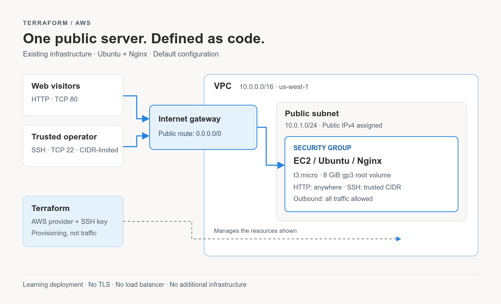

# Terraform AWS Nginx

A small Terraform learning project that provisions an AWS VPC, a public subnet,
and an Ubuntu EC2 instance running Nginx. SSH is limited to a trusted CIDR;
HTTP is publicly accessible.



## Infrastructure

- One VPC (`10.0.0.0/16`) with DNS support and DNS hostnames enabled.
- One public subnet (`10.0.1.0/24`) that assigns public IP addresses.
- An internet gateway, a public route table, and a default internet route.
- A security group allowing TCP 22 from `ssh_allowed_cidr`, TCP 80 from anywhere,
  and unrestricted outbound traffic.
- An imported SSH public key and one `t3.micro` EC2 instance by default.
- An 8 GiB `gp3` root volume, deleted when the instance terminates.
- Boot-time installation of Nginx and a simple static welcome page.

No new infrastructure features have been added in this cleanup.

## Prerequisites

- **Terraform 1.16.6**, matching the original exact version constraint.
- **AWS provider 6.70.0**, installed by `terraform init`.
- An AWS account, working AWS credentials, and permissions to manage the resources
  above. The AWS CLI is used by the verification commands below.
- A local SSH key pair and your current public IPv4 address.
- An Ubuntu AMI compatible with `t3.micro` in the chosen region. The supplied AMI
  is `ami-0fdcaf433b661372d` in `us-west-1`; verify its availability and ownership
  before use. AMI IDs are region-specific and can become unavailable.

Never commit AWS credentials, private keys, local `.tfvars`, Terraform state,
or saved plans. `.gitignore` excludes these common local files. Review staged
files before publishing. Commit `.terraform.lock.hcl` to keep provider selection
and checksums reproducible.

## Run the project

### 1. Get the repository

```bash
git clone https://github.com/yussuf-codes/terraform-aws-nginx.git
cd terraform-aws-nginx
```

### 2. Authenticate with AWS

Use your existing AWS CLI profile or your organization's supported credential
flow. For an already configured profile:

```bash
export AWS_PROFILE=your-profile
aws sts get-caller-identity
```

The provider reads standard AWS credentials. Do not put access keys in `.tf` files.

### 3. Prepare an SSH key

If you already have a suitable key pair, skip generation and set the matching
`public_key_path` and `private_key_path` values in the next step.

```bash
mkdir -p ~/ssh_keys
chmod 700 ~/ssh_keys
# Generate only if this path does not already contain a key you need.
ssh-keygen -t rsa -b 4096 -f ~/ssh_keys/aws_key -C terraform-aws
chmod 400 ~/ssh_keys/aws_key
```

The public key is uploaded to AWS; the private key stays on your computer.
`private_key_path` is used only to construct the SSH command output.

### 4. Configure local values

```bash
cp terraform.tfvars.example terraform.tfvars
```

Edit `terraform.tfvars` and replace the example `203.0.113.10/32` with your actual
public IPv4 address followed by `/32`. The included example is reserved for
documentation and will **not** provide SSH access from your computer.

Optional overrides use the existing variables, for example:

```hcl
ssh_allowed_cidr = "YOUR_PUBLIC_IPV4/32" # Replace this placeholder.
project_name     = "learn-terraform-aws"
aws_region       = "us-west-1"
public_key_path  = "~/ssh_keys/aws_key.pub"
private_key_path = "~/ssh_keys/aws_key"
```

Do not copy the placeholder literally. If changing regions, also set `ami_id`
to an Ubuntu AMI available in that region. The startup script uses `apt` and the
SSH command assumes the `ubuntu` user. Keep the key paths free of spaces when
using the generated SSH command as written.

### 5. Initialize, check, and plan

```bash
terraform init
terraform fmt -check -recursive
terraform validate
terraform plan -out=tfplan
```

Inspect the plan carefully. Planning contacts AWS and requires valid credentials,
a real SSH CIDR, and the public key file. Saved plans can contain sensitive values.

### 6. Apply

```bash
terraform apply tfplan
terraform output
```

Applying a saved plan does not ask for another approval. Run it only after
reviewing that plan. This creates billable AWS resources. Nginx installation can
take a few minutes after the EC2 instance is created.

### 7. Connect and verify

```bash
# Print the SSH command, then copy and run the displayed command.
terraform output -raw ssh_command
```

To retrieve the public IP with the AWS CLI and check HTTP from a POSIX shell:

```bash
# Use the same region as aws_region in your Terraform configuration.
AWS_REGION=us-west-1
INSTANCE_ID=$(terraform output -raw instance_id)
PUBLIC_IP=$(aws ec2 describe-instances \
  --region "$AWS_REGION" \
  --instance-ids "$INSTANCE_ID" \
  --query 'Reservations[0].Instances[0].PublicIpAddress' \
  --output text)
curl "http://$PUBLIC_IP"
```

You should see the Nginx welcome page containing “Hello from Nginx!”. You can also
open `http://PUBLIC_IP` in a browser after replacing the placeholder. Retry after
a few minutes if Nginx is still installing. If SSH fails after your IP changes,
update `ssh_allowed_cidr`, review a new plan, and apply it.

### 8. Clean up

```bash
terraform plan -destroy -out=tfplan
# Review the destruction plan before continuing.
terraform apply tfplan
```

This deletes the managed resources, including the EC2 root volume. Keep your
state files until cleanup is complete. Check AWS afterward for resources or
charges not managed by this configuration.

## Configuration reference

| Variable | Default | Purpose |
| --- | --- | --- |
| `aws_region` | `us-west-1` | AWS deployment region. |
| `project_name` | `learn-terraform-aws` | Prefix for AWS names and project tags. |
| `vpc_cidr` | `10.0.0.0/16` | VPC IPv4 CIDR block. |
| `subnet_cidr` | `10.0.1.0/24` | Public subnet CIDR; must fit within the VPC. |
| `ami_id` | `ami-0fdcaf433b661372d` | Ubuntu AMI; verify it in the selected region. |
| `instance_type` | `t3.micro` | EC2 instance type. |
| `public_key_path` | `~/ssh_keys/aws_key.pub` | Local public SSH key to import. |
| `private_key_path` | `~/ssh_keys/aws_key` | Local private-key path shown in the SSH output. |
| `ssh_allowed_cidr` | Required | Trusted SSH source, normally your public IPv4 `/32`. |

## Outputs

| Output | Meaning |
| --- | --- |
| `instance_id` | ID of the managed EC2 instance. |
| `ssh_command` | SSH command using the configured private-key path and instance public IP. |

## Repository layout

```text
.
├── .editorconfig
├── .gitignore
├── .terraform.lock.hcl
├── README.md
├── main.tf                    # VPC, subnet, gateway, routes, and association
├── outputs.tf
├── provider.tf                # AWS provider and default tags
├── terraform.tf               # Original Terraform and provider pins
├── terraform.tfvars.example   # Non-personal configuration example
├── variables.tf
└── docs/
    ├── architecture.png       # README illustration
    └── architecture.svg       # Editable vector illustration
```

Terraform loads the `.tf` files in this directory together. Splitting the files
does not add modules or change the deployment model.

## Learning-only limitations

This is not a production-hardened deployment. It retains the original public
HTTP endpoint without TLS, a single instance, unrestricted outbound access,
an unencrypted root volume, and local Terraform state. The public IP is not an
Elastic IP and can change. These settings were not altered because this task
explicitly excludes new features. AWS charges may apply; do not assume free-tier
eligibility.
